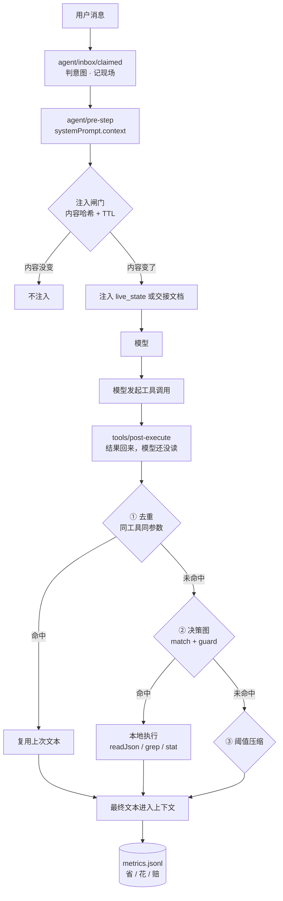

# dsh-memory-router

> 一个挂在 DSH 工具调用边界上的 Token 压缩插件：把模型「已经读过一次的东西」和「读不完的长输出」在进入上下文之前处理掉，并把省下的 token 记成账。


---

## 痛点

Agent 的每一次工具调用都有一次「回读」：工具返回 8000 字，模型为了决定下一步，要把这 8000 字重新读一遍。

三种情况下这是纯浪费：

| 情况 | 浪费 |
|---|---|
| 同一个文件/命令被调用两次 | 第二次的结果和第一次一样，模型又读一遍 |
| 工具返回 8000 字，模型只需要 4 个字段 | 剩下 7900 字白读 |
| 状态类问题每次都要重新注入一遍现场 | 同样的内容反复付费 |

HarnessMM（arXiv 2610.32813）把这类浪费称为「工具反馈后的无效推理回调」，并给出 EDG / GDR / CCS 三个机制。这个项目是那三个机制在 DSH 上的一个可运行等价实现。

---

## 三个模块

| 模块 | 做什么 | 状态 |
|---|---|---|
| `dedupe` 去重 | 同工具同参数，TTL 内直接复用上次的文本，工具不再执行 | 生产验证 |
| `edg` 决策图 | 声明式规则：匹配工具+参数，守卫为真就跑本地动作，用结构化结果替换原始输出 | 生产验证 |
| `liveState` 会话延续 | 自动落盘「在处理什么、动过哪些文件」，新会话第一轮注入 | 生产验证 |
| `inject` 注入闸门 | 内容哈希去重 + 长度上限 + 账面行限频 | 单测通过 |

---

## 真实数据

生产会话实测（不是模拟）：

| 场景 | 原生 | 插件后 | 省 |
|---|---|---|---|
| 读税则大表（8972 条） | 6031 字 | 298 字（总条数 + 3 条样本 × 4 字段） | 1433 token |
| 读盲推记录（26 KB） | 8035 字 | 1707 字（标题骨架 + 错误行 + 结论行） | 1582 token |
| 重复执行同一条命令 | 重新执行 | 命中缓存，未执行 | 账本记 dedupe |

十案例 A/B（`node scripts/ab.mjs`，可复现）：

| 项 | 数值 |
|---|---|
| 命中案例 | 6/10 |
| 命中时平均节省 | 96% |
| 合计（挑过的样本，是上界） | 93% |
| 按三成命中率折算 | 约 29% |

---

## 安装

```bash
git clone https://github.com/<you>/dsh-memory-router.git
cd dsh-memory-router && npm test      # 6 个测试套件，92 项
```

以本地插件方式挂进 DSH profile：

```bash
# 在 profile 的 node_modules 下建链接（Windows 用 mklink /J）
ln -s /path/to/dsh-memory-router ~/.dsh/profiles/web/node_modules/@local/dsh-memory-router
```

重启 DSH 后生效。决策图配置放 `~/.dsh/memory-router/edg.json`（示例见 `edg.example.json`）。

一个节点长这样：

```json
{
  "id": "tax-table-pick-fields",
  "match": { "tool": "read", "args": { "file_path": { "$re": "hs_codes" } } },
  "guard": { "minChars": 2000 },
  "then": [
    { "act": "readJson", "path": "${args.file_path}", "limit": 3,
      "pick": ["hs_code", "name", "import_tariff", "category"] }
  ]
}
```

守卫只有五个纯本地算子（`exitCode` / `fileExists` / `regex` / `minChars` / `jsonPath`），动作只有四个只读动作（`readJson` / `readFileSlice` / `grep` / `stat`）。写 `exec` 会直接抛错——决策图写错，最坏结果是退化成没有它。

---

## 局限（请先读完这段再决定要不要 Star）

**累计净收益目前是负的。**

```
裁剪省 1223  ·  去重省 0（2 次）  ·  决策图省 3015（2 次）
重读赔 0     ·  注入花 14755     ·  净 −10517
```

原因有两个：

1. 注入开销是历史累积的，其中大部分发生在「注入闸门」装上之前；
2. 我的验证方式把它放大了：一直在同一类问句上反复测。

单次命中省 1400—1600 token 是真的；「长期净收益为正」还没被证明。

**与论文的差距：不能跳过模型回合。**

论文的 GDR 是「用持久决策替换后续推理回调」，我们做不到——DSH 的 `PostToolDecision` 只有 `accept` / `block` 两支，没有「执行下一个动作」这一支。

所以本项目做的是：**插件自己执行确定性动作，把结果塞回这次工具调用的返回值**。省的是上下文体积，不是回合数。

论文的 87.93% 是在 HumanEval 这种强重复链上测的，照搬那个数字会误导。我们这类写作与调研负载，能拿到的是个位数到十几个百分点的往返节省。

**我们自己加了一个负收益科目：`reread`。**

论文没有这一项。没有它，账本会系统性虚高——压缩越多，账面越省，实际可能越贵（模型压缩过头 → 重新读一遍 → 更贵）。所以每次压缩后同一调用再来，记一笔亏损。

---

## 架构



处理顺序是固定的：**去重 → 决策图 → 阈值压缩 → 缓存最终文本**。任一步抛异常都回落，不阻断主循环。

---

## 记账口径

```
净收益 = 裁剪省 + 去重省 + 决策图省 − 重读赔 − 注入花 − 摘要花
```

| 科目 | 记什么 |
|---|---|
| `trim` | 压缩省下的 |
| `trim-skip` | 省得太少没压的次数（不进账） |
| `dedupe` | 复用缓存省下的 |
| `edg` | 本地执行替换输出省下的 |
| `reread` | 负收益：上次压过，同一调用又来了 |
| `inject` | 注入花的 |

查看账本：

```bash
node scripts/stats.mjs
```

---

## 目录

```
index.js            主逻辑（钩子接线、注入、去重、决策图、压缩）
lib/dedupe.js       哈希 + TTL LRU 缓存
lib/edg.js          决策图载入、匹配、守卫求值、本地动作
lib/live_state.js   会话延续状态
lib/metrics.js      CCS 记账
edg.example.json    五个节点的示例决策图
scripts/stats.mjs   账本汇总
scripts/ab.mjs      十案例 A/B（可复现）
tests/              6 套 92 项
```

---

## License

MIT（提交前请补 `LICENSE` 文件）。

## 致谢

对标 HarnessMM: <https://arxiv.org/abs/2610.32813>
